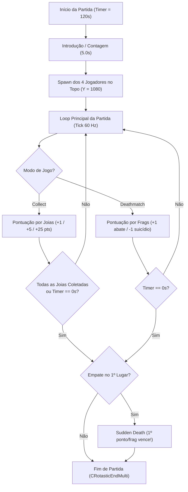

# Especificação de Gameplay — Rotastic Multiplayer

Este documento descreve as regras completas de partida, modos multiplayer, sistema de pontuação, itens/joias, ciclo de vida do jogador (spawn/morte/respawn), condição de vitória, *Sudden Death* e o catálogo detalhado dos **19 mapas multiplayer** extraídos de [`Rotastic.exe`](file:///c:/Users/rafae/Documents/Coding/Vibecoding/Decompilation/rotastic/reference/game-files/Rotastic.exe) e [`reference/decompiled/multiplayer-maps-spec.json`](file:///c:/Users/rafae/Documents/Coding/Vibecoding/Decompilation/rotastic/reference/decompiled/multiplayer-maps-spec.json).

---

## 1. Visão Geral da Partida Multiplayer (2 a 4 Jogadores)

- **Capacidade da Sala:** 2 a 4 jogadores (slots `Player 1..4`, podendo ser preenchidos por humanos ou bots `CAIPlayerController`).
- **Personagens / Slots (`PRP_player1..4`):**
  - `Player 1`: malha `o_character_a_neo_spawn` (Vermelho/Laranja — Viking principal)
  - `Player 2`: malha `o_character_b_neo_spawn` (Azul)
  - `Player 3`: malha `o_character_c_neo_spawn` (Verde)
  - `Player 4`: malha `o_character_d_neo_spawn` (Amarelo/Roxo)
- **Duração Padrão da Partida (`CRotasticTimer`):** $120.0\text{ segundos}$ ($2\text{ minutos}$) em todos os 19 mapas multiplayer (`matchTimerSeconds = 120`).
- **Contagem Regressiva Inicial (`CRotasticIntroductionGeneric`):** $5.0\text{ s}$ de introdução antes do primeiro spawn (`initialDelay = 5.0 s`).

---

## 2. Modos de Jogo Multiplayer

O jogo possui dois modos multiplayer competitivos implementados pelas classes nativas [`CModeMultiDeathMatch`](file:///c:/Users/rafae/Documents/Coding/Vibecoding/Decompilation/rotastic/reference/decompiled/disasm/CModeMultiDeathMatch.asm) (`0x00531C70..0x00532BA0`) e [`CModeMultiCollecte`](file:///c:/Users/rafae/Documents/Coding/Vibecoding/Decompilation/rotastic/reference/decompiled/disasm/CModeMultiCollecte.asm) (`0x005315E0..0x00531C60`), herdando de `CRotasticGameModeMulti`.

### 2.1 Modo 1: Deathmatch / "Brawl" (`CModeMultiDeathMatch`, `0x00531C70`)

- **Objetivo:** Obter o maior número de abates (*frags*) antes do término dos $120\text{ segundos}$ (ou atingir o limite de frags configurado no lobby).
- **Janela de Atribuição de Abate (`5.0 segundos`, `0x0056CFA0` & `0x005421F0`):**
  - Sempre que um jogador $A$ **colide fisicamente** com o jogador $B$ (`HandlePlayerVsPlayerCollision`, `0x0056CD80`) ou **corta a corda** de $B$ (`CRotasticPlayer::OnRopeCutByPlayer`, `0x005421F0`), o jogo grava no estado de $B$:
    - `B.lastAttacker = A` (`[B + 0xDF0] = A`)
    - `B.killAttributionTimer = 5.0f` (`[B + 0xDF4] = 0x40A00000`)
  - O timer `[B + 0xDF4]` decai linearmente com $\Delta t$ a cada tick (`0x0056BE30`); se zerar enquanto $B$ sobrevive, `B.lastAttacker` é limpo para `NULL`.
- **Regras de Pontuação ao Morrer (`CModeMultiDeathMatch::OnPlayerKilled`, `0x00532050`):**
  Quando o jogador $B$ morre (cruza $Y \le -300$ em `TriggerPlanePlayerDeath` ou toca uma parede mortal):
  1. **Abate Válido (`B.lastAttacker != NULL` e `B.lastAttacker != B`):**
     - O atacante $A = \text{B.lastAttacker}$ ganha **$+1\text{ frag}$** (`CPlayerData::AddFrag(A, +1)` em `0x005320A8`).
     - Dispara o evento visual `OnPlayerFragCountUpdate` (`PRP_PlusOnePlayer*` exibe `+1` sobre a cabeça de $A$).
  2. **Suicídio / Queda Sem Atacante (`B.lastAttacker == NULL` ou `B.lastAttacker == B`):**
     - O próprio jogador $B$ perde **$-1\text{ frag}$** (`CPlayerData::AddFrag(B, -1)`, ou limitado a $0$ conforme flag `[modeRef + 0x20]`).
     - Dispara o evento visual `PRP_MinusOnePlayer*` (`-1`).

---

### 2.2 Modo 2: Collect / "Jewel Collector" (`CModeMultiCollecte`, `0x005315E0`)

- **Objetivo:** Coletar o maior valor total em joias antes que o cronômetro de $120\text{ s}$ zere ou que todas as joias do mapa sejam coletadas.
- **Tabela de Joias e Itens (`CPickUp::OnCollect`, `0x00537B80`):**
  Cada entidade `CPickUp` possui um enumerador em `[pickup + 0x1E8]` (`pickupEnum` em [`multiplayer-maps-spec.json`](file:///c:/Users/rafae/Documents/Coding/Vibecoding/Decompilation/rotastic/reference/decompiled/multiplayer-maps-spec.json)):

| `pickupEnum` (`[+0x1E8]`) | Categoria Simbólica | Malha 3D (`meshName`) | Pontos (`CPlayerData::AddScore`) | Endereço ASM (`CPickUp.asm`) | Efeito Especial |
| :---: | :--- | :--- | :---: | :--- | :--- |
| `1` | `jewel_blue_5pt` | `o_coina` | **$+5\text{ pts}$** | `0x00537BCA` (`push 5`) | Incrementa contador de joias coletadas |
| `2` | `jewel_green_5pt` | `o_coinb` | **$+5\text{ pts}$** | `0x00537BE3` (`push 5`) | Incrementa contador de joias coletadas |
| `3` | `jewel_yellow_1pt` | `o_coinc` | **$+1\text{ pt}$** | `0x00537BFA` (`push 1`) | Joia básica de cobre/amarela |
| `4` | `jewel_red_25pt` | `o_coind` / `o_coing` | **$+25\text{ pts}$** | `0x00537C13` (`push 0x19`) | Joia rara de alto valor |
| `5` | `diamond_powerup` | `o_diamond*` | **$0\text{ pts}$** | `0x00537C2A` (`call 0x00542150`) | Ativa **UberBeam** no jogador (`CRotasticPlayer::ActivateItem`) |

- **Raio de Coleta de `CPickUp`:** Bounding box local `[-75, -75] .. [75, 75]` com `SimBodySphere` de raio efetivo de coleta $\approx 45\text{ u}$ (colisão centro-a-centro jogador + joia).
- **Combate durante o Modo Collect:** O corte de corda, choque elástico PvP e paredes mortais continuam **100% ativos** no modo Collect! Derrubar adversários no abismo faz com que eles percam $3.0\text{ s}$ de tempo de respawn, impedindo-os de coletar joias, mas **mortes não alteram a pontuação de joias**.

---

## 3. Ciclo de Spawn, Morte, Respawn e Sudden Death

### 3.1 Spawns no Topo da Tela (`CSpawnArea` / `CSpawnPoint`)
Em todos os mapas multiplayer, os 4 jogadores nascem no topo da tela ($Y = 1080.0\text{ u}$) ao longo de splines horizontais (`splinePlayer1..4`) e entram em queda livre (`STATE_FREE_FALL`) com invulnerabilidade inicial de `respawnInvulnDuration = 1.00 s`:
- **Coordenadas $X$ Padrão de Spawn:**
  - `Player 1`: $X = 234.0,\; Y = 1080.0$
  - `Player 2`: $X = 618.0,\; Y = 1080.0$
  - `Player 3`: $X = 1002.0,\; Y = 1080.0$
  - `Player 4`: $X = 1386.0,\; Y = 1080.0$
  *(Alguns mapas ajustam o espaçamento horizontal conforme a geometria de paredes do topo; todos os valores exatos por mapa estão em [`reference/decompiled/multiplayer-maps-spec.json`](file:///c:/Users/rafae/Documents/Coding/Vibecoding/Decompilation/rotastic/reference/decompiled/multiplayer-maps-spec.json).)*
- **Tempo de Respawn após Morte:** $3.0\text{ segundos}$ (`respawnDelay = 3.0 s`).

### 3.2 Carga de Escudo e *UberBeam* (`CRotasticRopeUberBeam`)
- **Escudo / Ataque Carregado Padrão (`chargeGauge`, `[+0xCF8]`):**
  - Sempre que a velocidade do jogador $\|\vec{v}\| \ge 450.0\text{ u/s}$, a barra `chargeGauge` sobe a $0.58\text{ s}^{-1}$ ($\approx 1.724\text{ s}$ para encher).
  - Quando `chargeGauge == 1.0`, `shieldReady` (`[+0xCFC]`) fica ativo: o jogador ganha aura luminosa e vence colisões diretas contra jogadores sem carga (atordoando o alvo por $0.55\text{ s}$ e desconectando sua corda).
- **Power-up *UberBeam* (`CRotasticPlayer::ActivateItem`, `0x00542150`):**
  - Ativado ao coletar um pickup tipo `5` (`diamond_powerup`) ou gatilho de item.
  - Energiza a corda do jogador (`CRotasticRopeUberBeam`, `0x00548290`), tornando-a invulnerável a cortes por adversários e capaz de atordoar/cortar adversários que toquem nela.

### 3.3 Coroa de Líder e *Sudden Death* (`0x00532770` & `0x00531A40`)
- **Coroa do 1º Lugar (`PRP_CrownPlayer1..4`):**
  - Sempre que o ranking muda, o jogador em 1º lugar isolado recebe o ícone de coroa (`OnBecameFirst`); ao perder a liderança, dispara `OnBecameSecond`.
- **Desempate (*Sudden Death*):**
  - Quando o cronômetro de $120\text{ s}$ chega a zero, `CModeMultiDeathMatch::CheckWinCondition` (`0x00532770`) e `CModeMultiCollecte::CheckWinCondition` (`0x00531A40`) comparam a maior pontuação entre os jogadores ativos.
  - Se houver **empate no 1º lugar**, a partida entra em **Sudden Death**: o primeiro jogador empatado que conquistar $+1\text{ frag}$ (no Deathmatch) ou coletar uma joia (no Collect) encerra imediatamente a partida como vencedor.

---

## 4. Catálogo Completo dos 19 Mapas Multiplayer

Todos os 19 pacotes de nível multiplayer foram extraídos e estruturados em [`reference/decompiled/multiplayer-maps-spec.json`](file:///c:/Users/rafae/Documents/Coding/Vibecoding/Decompilation/rotastic/reference/decompiled/multiplayer-maps-spec.json). A tabela abaixo resume cada mapa:

| ID do Mapa (`mapId`) | Modo | Timer | Pivôs (`CAttachPoint`) | Paredes (`CWall`) | Joias (`CPickUp`) | Vórtices (`CGravityVortex`) | Características de Level Design |
| :--- | :--- | :---: | :---: | :---: | :---: | :---: | :--- |
| `w_multi_coll_lvl01` | Collect | `120s` | `6` | `7` | `68` (`68×1pt`) | `0` | Arena clássica simétrica com 6 pivôs em 3 fileiras e paredes elásticas laterais |
| `w_multi_coll_lvl03` | Collect | `120s` | `6` | `4` | `207` (`5pt` / `1pt`) | `1` (`(960, 540)`, $G=687$, $R=200$) | **Mapa do Vórtice Central**: grande anel de 207 joias orbitando um vórtice gravitacional central |
| `w_multi_coll_lvl04` | Collect | `120s` | `4` | `7` | `43` | `0` | Arena compacta de 4 pivôs com obstáculos internos e corredores estreitos |
| `w_multi_coll_lvl05` | Collect | `120s` | `5` | `9` | `90` | `0` | Labirinto de 9 paredes e 5 pivôs em quincunce (4 cantos + 1 central) |
| `w_multi_coll_lvl07` | Collect | `120s` | `5` | `3` | `53` | `0` | Arena aberta no fundo com 5 pivôs e alta exigência de controle de corda |
| `w_multi_dm_lvl01` | Deathmatch | `120s` | `6` | `4` | `0` | `0` | Arena padrão de Deathmatch: 6 pivôs (`(720,860), (1200,860), (300,540), (1620,540), (720,220), (1200,220)`) e 4 paredes de rebote |
| `w_multi_dm_lvl02` | Deathmatch | `120s` | `4` | `4` | `0` | `0` | Combate rápido em losango de 4 pivôs com bordas elásticas |
| `w_multi_dm_lvl04` | Deathmatch | `120s` | `5` | `7` | `0` | `0` | Arena de 5 pivôs com 7 segmentos de parede (incluindo perigos internos) |
| `w_multi_dm_lvl07` | Deathmatch | `120s` | `5` | `5` | `0` | `0` | 5 pivôs com paredes anguladas e abismo inferior amplo |
| `w_multi_dm_lvl09` | Deathmatch | `120s` | `4` | `6` | `0` | `0` | 4 pivôs cercados por 6 paredes de colisão intensa |
| `w_multi_dm_lvl10` | Deathmatch | `120s` | `4` | `3` | `0` | `0` | Arena aberta minimalista (apenas 3 paredes superiores/laterais e grande abismo) |
| `w_multi_dm_lvl11` | Deathmatch | `120s` | `5` | `5` | `0` | `0` | 5 pivôs em cruz com 5 barreiras |
| `w_multi_dm_lvl13` | Deathmatch | `120s` | `5` | `3` | `0` | `0` | Arena avançada de 5 pivôs e 3 paredes |
| `w_ps3_collect_2` | Collect (Bot/Demo) | `120s` | `5` | `3` | `53` | `0` | Variante PS3/Demo de `w_multi_coll_lvl07` com suporte a IA (`CAIPlayerController`) |
| `w_ps3_collect_3` | Collect (Bot/Demo) | `120s` | `6` | `7` | `68` | `0` | Variante PS3/Demo de `w_multi_coll_lvl01` |
| `w_ps3_collect_4` | Collect (Bot/Demo) | `120s` | `4` | `7` | `43` | `0` | Variante PS3/Demo de `w_multi_coll_lvl04` |
| `w_ps3_deathmatch_2` | Deathmatch (Bot/Demo) | `120s` | `4` | `3` | `0` | `0` | Variante PS3/Demo de `w_multi_dm_lvl10` |
| `w_ps3_deathmatch_3` | Deathmatch (Bot/Demo) | `120s` | `5` | `3` | `0` | `0` | Variante PS3/Demo de `w_multi_dm_lvl13` |
| `w_ps3_deathmatch_4` | Deathmatch (Bot/Demo) | `120s` | `5` | `5` | `0` | `0` | Variante PS3/Demo de `w_multi_dm_lvl11` |
