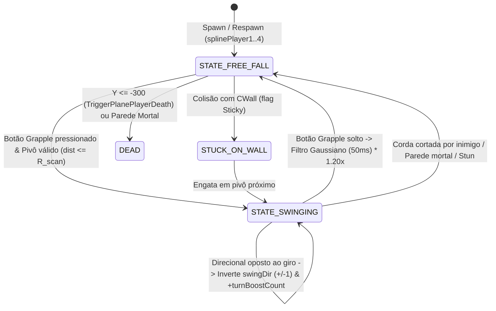

# Especificação de Física — Rotastic Multiplayer

Este documento especifica a matemática exata, constantes numéricas, máquina de estados física, modelo de colisão e integração temporal do motor de física de **Rotastic**, extraídos diretamente do binário nativo x86 ([`Rotastic.exe`](file:///c:/Users/rafae/Documents/Coding/Vibecoding/Decompilation/rotastic/reference/game-files/Rotastic.exe)) e dos pacotes de nível ([`reference/decompiled/multiplayer-maps-spec.json`](file:///c:/Users/rafae/Documents/Coding/Vibecoding/Decompilation/rotastic/reference/decompiled/multiplayer-maps-spec.json)).

---

## 1. Arquitetura do Motor Físico e Determinismo

### 1.1 Física Própria Customizada (`CRotasticPhysicPlayer`) vs. PhysX
Conforme comprovado na [Fase 1 (`docs/02-code-map.md`)](file:///c:/Users/rafae/Documents/Coding/Vibecoding/Decompilation/rotastic/docs/02-code-map.md), o executável **não utiliza Box2D, Havok ou PhysX para a mecânica de jogo**. Embora a engine base Focus Home / BlitzTech ("FEngine") possua wrappers `SimBodySphere` / `SimBodyBox` para detecção broadphase de sobreposição (`Overlap`), **100% da cinemática do jogador, pendular na corda, lançamento com filtro Gaussiano, ricochete em paredes, vórtice gravitacional e choque elástico PvP** é resolvida analiticamente em C++ puro na classe **`CRotasticPhysicPlayer`** ([`CRotasticPhysicPlayer.asm`](file:///c:/Users/rafae/Documents/Coding/Vibecoding/Decompilation/rotastic/reference/decompiled/disasm/CRotasticPhysicPlayer.asm), `0x0056A300..0x00577200`).

### 1.2 Sistema de Coordenadas e Viewport de Referência
- **Plano de Jogo:** 2D estrito no plano $(X, Y)$, com $Z = 0$ para todas as entidades de gameplay.
- **Resolução Lógica Fixa (`ec_stock_viewport_size`):** `1920 × 1080` unidades lógicas.
  - Origem $(0, 0)$ no canto **inferior esquerdo** da tela.
  - Eixo $+X$: aponta para a **direita** ($X \in [0, 1920]$).
  - Eixo $+Y$: aponta para **cima** ($Y \in [0, 1080]$).
  - Gravidade padrão aponta para **baixo**: $\vec{g} = (0.0, -686.7, 0.0)\text{ u/s}^2$ ($-70 \times 9.81$).
- **Margem Fora de Tela (`oobMargin`, `0x0056C352`):** $32.0\text{ u}$ em torno de `1920 × 1080`, definindo a caixa ativa $[-32.0, 1952.0] \times [-32.0, 1112.0]$.
- **Plano de Morte (`TriggerPlanePlayerDeath`):** $Y_{\text{kill}} = -300.0\text{ u}$ (centro em $X = 960, Y = -300$, largura $[-1250, +1250]$).

### 1.3 Passo de Integração (`dt`) e Histórico Circular de 64 Amostras
- A função principal de passo físico é `CRotasticPhysicPlayer::UpdatePhysics` (`0x0056BC60`), invocada por `CRotasticPlayer::Update` (`0x00542AD0`).
- Em cada tick, o motor armazena a velocidade linear instantânea $(v_x, v_y, v_z)$ e o timestamp acumulado $t_{\text{sim}}$ (`[player + 0xCE4]`) em um **buffer circular de 64 posições** em `[player + 0x82C]` (stride de `16 bytes` por amostra: `{ float vx, vy, vz, timestamp }`, índice atual em `[player + 0xC2C]`, contador saturado em $64$ em `[player + 0xC30]`).
- Para o servidor autoritativo web (Fase 4), utilizaremos **tick fixo determinístico de $60\text{ Hz}$** ($\Delta t = \frac{1}{60}\text{ s} \approx 0.016667\text{ s}$), garantindo que a janela de lookback de $50\text{ ms}$ corresponda exatamente às últimas $3\text{ a }4$ amostras do buffer circular.

---

## 2. Tabela Completa de Constantes (`RotasticSimulation` RefData)

Em `CRotasticPlayer::BindSimulation` (`0x0054177D`), o jogador sobe na árvore `WorldNode` até encontrar a entidade `RotasticSimulation` (`refdata_rotasticsimulation_0x784ff55a`) e grava seu ponteiro em `[player + 0x1E4]`. Imediatamente calcula o comprimento nominal da corda:

$$R_{\text{base}} = \frac{\text{ref}[\text{+0x18}]}{\text{ref}[\text{+0x1C}]} = \frac{900.0}{6.0} = 150.0\text{ u}$$

A tabela abaixo lista todos os parâmetros de `[player + 0x1E4]` extraídos dos pacotes `*_refm.pc` e `*_fetm.pc` (idênticos em todos os 19 mapas multiplayer):

| Offset Struct | Hash `REFD` | Nome Simbólico | Valor (`FETM`) | Default Schema | Unidade | Papel no Código Nativo (`Rotastic.exe`) |
| :--- | :--- | :--- | :---: | :---: | :---: | :--- |
| `WorldNodeSim` | `0x59127227` | `gravity` | `(0, -686.7, 0)` | `(0, -9.81, 0)` | $\text{u/s}^2$ | Vetor gravidade lido via `0x00540850` |
| `+0x10` | `0xD5D36E94` | `airDampingScalar` | `0.0015` | `0.985` | adim. | Escalar fallback/amortecimento linear (`0x00540872`) |
| `+0x14` | `0xDEFE543F` | `maxLinearSpeed` | `2000.0` | `2500.0` | $\text{u/s}$ | Clamp de velocidade linear máxima em voo livre e colisão (`0x0056A7AE`, `0x00576DCA`) |
| `+0x18` | `0x41ADDA19` | `baseMaxTangentialSpeed` | `900.0` | `900.0` | $\text{u/s}$ | Velocidade tangencial máxima base na corda ($v_{\max,\text{base}}$, `0x0056A5BF`) |
| `+0x1C` | `0xF87D6EA9` | `baseMaxAngularSpeed` | `6.0` | `6.0` | $\text{rad/s}$ | Velocidade angular máxima base ($\omega_{\max,\text{base}}$, define $R_{\text{base}} = 150.0\text{ u}$) |
| `+0x20` | `0x71AA050C` | `turnBoostSpeedPerStack` | `60.0` | `60.0` | $\text{u/s}$ | Bônus de velocidade tangencial por acúmulo de inversão de giro (`0x0056A5BA`) |
| `+0x24` | `0x10C5F28F` | `turnBoostCosBase` | `0.80` | `0.80` | $\cos\theta$ | Limiar base de alinhamento tangencial para ganhar stack de giro (`0x0056B039`) |
| `+0x28` | `0x651AAF33` | `turnBoostCosStep` | `0.04` | `0.04` | $\cos\theta$ | Incremento do limiar de cosseno por stack acumulado (`0x0056B033`) |
| `+0x2C` | `0x0D2DF80B` | `swingBoostTargetSpeed` | `1300.0` | `1300.0` | $\text{u/s}$ | Velocidade tangencial alvo durante boost ativo (`0x0056B0FF`) |
| `+0x30` | `0x4D88CC18` | `swingBoostDuration` | `0.40` | `0.40` | $\text{s}$ | Duração do timer de boost de giro `[player + 0xC4C]` (`0x0056B094`) |
| `+0x34` | `0xE0C2CBDB` | `tangentialGravityScale` | `10.0` | `10.0` | adim. | Multiplicador de aceleração tangencial gravitacional na corda (`0x0056A755`) |
| `+0x38` | `0xF1755CF8` | `releaseLookbackWindow` | `0.05` | `0.05` | $\text{s}$ | Janela de lookback ($50\text{ ms}$) no histórico de velocidade ao soltar a corda (`0x0056AA8F`) |
| `+0x3C` | `0x2477BDBB` | `releaseGaussianSigma` | `0.8409` | `0.8409` | adim. | Parâmetro $\sigma = 2^{-1/4}$ do filtro Gaussiano de lançamento (`0x0056AB0F`) |
| `+0x40` | `0x7EF2D784` | `releaseBoostMultiplier` | `1.20` | `1.20` | adim. | Multiplicador de impulso aplicado ao vetor velocidade ao soltar a corda (`0x0056AB98`) |
| `+0x44` | `0xB75E643C` | `wallBounceRestitution` | `1.00` | `0.75` | adim. | Coeficiente de restituição do jogador em colisão com parede (`0x00576A15`) |
| `+0x48` | `0x6E5522A2` | `grappleReattachLockout` | `0.05` | `0.10` | $\text{s}$ | Cooldown mínimo (`[+0xC50]`) antes de re-engatar após soltar (`0x0056B910`) |
| `+0x4C` | `0xB39402FA` | `chargeFillRate` | `0.58` | `0.70` | $\text{s}^{-1}$ | Taxa de carregamento do escudo/ataque (`[+0xCF8]`, $\approx 1.724\text{ s}$ até $1.0$, `0x0056CB26`) |
| `+0x50` | `0xB43DE899` | `minSpeedForChargeAndPvp` | `450.0` | `450.0` | $\text{u/s}$ | Velocidade mínima para carregar barra e clamp mínimo de colisão PvP (`0x0056CB0A`, `0x00576EEF`) |
| `+0x54` | `0xFAB7A87E` | `stunChargeMultiplier` | `1.00` | `1.00` | adim. | Escalar de carga/atordoamento |
| `+0x58` | `0x8D6D15AC` | `stunDuration` | `0.55` | `0.55` | $\text{s}$ | Duração do estado atordoado (`[+0xD50]`) ao perder escudo/ser atingido (`0x0056CD80`) |
| `+0x5C` | `0x0B3550C9` | `respawnInvulnDuration` | `1.00` | `0.20` | $\text{s}$ | Duração de invulnerabilidade pós-spawn/hit (`[+0xD54]`, `0x0056CBA6`) |
| `+0x74` | `0x0D1FA3F4` | `oobReelinSpeed` | `50.0` | `50.0` | $\text{u/s}$ | Velocidade de recolhimento automático da corda quando fora da tela (`0x0056BCE8`) |
| `+0x78` | `0x35152825` | `oobMargin` | `32.0` | `32.0` | $\text{u}$ | Margem externa ao viewport `1920 × 1080` para detecção de OOB (`0x0056C352`) |
| `+0x7C` | `0xA3FDE478` | `allowRegrappleOnFreshPress` | `true` (`1`) | `false` (`0`) | bool | Permite engatar imediatamente em novo clique do botão de ação (`0x0056BBF0`) |

---

## 3. Layout de Memória do Jogador Físico (`CRotasticPhysicPlayer`)

| Offset | Tipo | Nome Simbólico | Descrição |
| :--- | :--- | :--- | :--- |
| `+0x1E4` | `RotasticSimulation*` | `simRef` | Ponteiro para a tabela de constantes `RotasticSimulation` |
| `+0x81C` | `uint32` | `physicsState` | `0 = STATE_FREE_FALL` (voo livre), `1 = STATE_SWINGING` (preso ao pivô) |
| `+0x820..+0x828` | `float[3]` | `vel` | Velocidade linear atual $\vec{v} = (v_x, v_y, 0)$ |
| `+0x82C..+0xC2B` | `VelSample[64]` | `velHistory` | Ring buffer de 64 amostras `{ float vx, vy, vz, timestamp }` |
| `+0xC2C` | `int32` | `velHistoryHead` | Índice de escrita atual no ring buffer ($0..63$) |
| `+0xC30` | `int32` | `velHistoryCount` | Total de amostras válidas no ring buffer ($0..64$) |
| `+0xC34` | `CAttachPoint*` | `currentPivot` | Pivô (`CAttachPoint`) ao qual o jogador está conectado |
| `+0xC38` | `int32` | `swingDir` | Sentido de rotação na corda: $+1$ (anti-horário / CCW) ou $-1$ (horário / CW) |
| `+0xC3C` | `float` | `angularSpeed` | Velocidade angular escalar $\omega \ge 0$ ($\text{rad/s}$) |
| `+0xC40` | `float` | `ropeRadius` | Comprimento atual da corda $R = \|\vec{p} - \vec{p}_{\text{pivot}}\|$ |
| `+0xC44` | `float` | `baseRopeRadius` | Comprimento nominal $R_{\text{base}} = 150.0\text{ u}$ |
| `+0xC48` | `uint32` | `turnBoostCount` | Stacks acumulados de inversão de giro ($0..5$) |
| `+0xC4C` | `float` | `swingBoostTimer` | Timer restante do boost de giro ($0.0..0.40\text{ s}$) |
| `+0xC50` | `float` | `regrappleCooldown` | Cooldown restante para re-engatar ($0.0..0.05\text{ s}$) |
| `+0xCB8..+0xCC0` | `float[3]` | `pos` | Posição atual do jogador $\vec{p} = (x, y, 0)$ |
| `+0xCE4` | `float` | `simTime` | Tempo acumulado de simulação ($t_{\text{sim}}$) |
| `+0xCF8` | `float` | `chargeGauge` | Barra de carga/escudo ($0.0..1.0$) |
| `+0xCFC` | `uint8` | `shieldReady` | `1` quando `chargeGauge >= 1.0` (escudo/ataque carregado ativo) |
| `+0xD00` | `float` | `playerRadius` | Raio de colisão esférico do jogador ($r_p \approx 32.0\text{ u}$) |
| `+0xD04` | `float` | `playerMass` | Massa do jogador ($m = 1.0$, `SimBodySphere`) |
| `+0xD50` | `float` | `stunTimer` | Timer de atordoamento/quebra de escudo ($0.55\text{ s}$) |
| `+0xD54` | `float` | `invulnTimer` | Timer de invulnerabilidade ($1.00\text{ s}$) |
| `+0xD58` | `CWall*` | `stuckWall` | Ponteiro para parede adesiva (`sticky wall`) se colado, ou `NULL` |
| `+0xD64` | `uint32` | `isOutOfBounds` | `1` se fora de $[-32, 1952] \times [-32, 1112]$ |
| `+0xDF0` | `CRotasticPlayer*` | `lastAttacker` | Último jogador adversário que causou colisão ou cortou a corda |
| `+0xDF4` | `float` | `killAttributionTimer` | Janela de $5.0\text{ s}$ (`0x40A00000`) para crédito de abate (frag) |

---

## 4. Máquina de Estados Física e Equações de Movimento

### 4.1 Estado `0`: Voo Livre (`STATE_FREE_FALL`, `0x0056A720`)

Quando o jogador não está preso a um pivô (`[player + 0x81C] == 0`) e não está colado em uma parede adesiva (`[player + 0xD58] == NULL`):

1. **Aceleração Gravitacional + Vórtices:**
   $$\vec{a} = \vec{g}_{\text{world}} + \sum_{k} \vec{a}_{\text{vortex}, k}(\vec{p})$$
   onde $\vec{g}_{\text{world}} = (0.0, -686.7, 0.0)\text{ u/s}^2$.
2. **Integração Semi-Implícita de Euler (`0x0056A786`):**
   $$\vec{v}(t + \Delta t) = \vec{v}(t) + \vec{a} \cdot \Delta t$$
3. **Clamp de Velocidade Linear Máxima (`0x0056A7AE`):**
   Se $\|\vec{v}\| > v_{\text{linear},\max}$ ($2000.0\text{ u/s}$):
   $$\vec{v} \leftarrow \vec{v} \cdot \frac{2000.0}{\|\vec{v}\|}$$
4. **Atualização de Posição:**
   $$\vec{p}(t + \Delta t) = \vec{p}(t) + \vec{v}(t + \Delta t) \cdot \Delta t$$
5. **Reset de Stacks de Giro:** Enquanto em voo livre, `turnBoostCount` (`[+0xC48]`) permanece em $0$.

---

### 4.2 Seleção de Pivô e Engate da Corda (`0x0056AC80` & `0x0056AEC0`)

1. **Busca do Pivô Mais Próximo (`FindBestAttachPoint`, `0x0056B6C0`):**
   - Percorre todos os `CAttachPoint` ativos no mapa (`[attachPoint + 0x1E8] != 0`).
   - Ignora pivôs bloqueados e verifica se a distância euclidiana $d = \|\vec{p} - \vec{p}_{\text{pivot}}\|$ está dentro do raio de alcance do jogador.
   - Seleciona o pivô de **menor distância quadrática** $d^2 = \Delta x^2 + \Delta y^2$.
2. **Transição `AttachToPoint` (`0x0056AEC0`):**
   - Define `physicsState = 1`, `currentPivot = pivot`, `ropeRadius = d` ($\|\vec{p} - \vec{p}_{\text{pivot}}\|$).
   - Calcula o vetor radial unitário do pivô até o jogador:
     $$\hat{r} = \frac{\vec{p} - \vec{p}_{\text{pivot}}}{\|\vec{p} - \vec{p}_{\text{pivot}}\|} = (\cos\theta, \sin\theta)$$
   - Determina o sentido inicial de rotação `swingDir` $\in \{-1, +1\}$ pelo sinal do produto vetorial 2D entre $\hat{r}$ e a velocidade de entrada $\vec{v}$:
     $$\tau_z = r_x v_y - r_y v_x \implies \text{swingDir} = \begin{cases} +1 & \text{se } \tau_z \ge 0 \text{ (anti-horário / CCW)} \\ -1 & \text{se } \tau_z < 0 \text{ (horário / CW)} \end{cases}$$
   - Define o vetor tangente unitário na direção do giro:
     $$\hat{t} = \text{swingDir} \cdot (-\sin\theta, \cos\theta) = \text{swingDir} \cdot (-r_y, r_x)$$
   - Projeta a velocidade linear de entrada na direção tangente e converte em velocidade angular $\omega = \frac{|\vec{v} \cdot \hat{t}|}{R}$, limitada a $\omega_{\max}(R)$.

---

### 4.3 Estado `1`: Movimento Pendular na Corda (`STATE_SWINGING`, `0x0056A5B0`)

Enquanto preso ao pivô $\vec{p}_{\text{pivot}}$ com raio atual $R = \text{ropeRadius}$:

1. **Limite de Velocidade Tangencial e Angular (`GetMaxAngularSpeed`, `0x0056A5B0`):**
   Com $k = \text{turnBoostCount} \in \{0, 1, 2, 3, 4, 5\}$:
   $$v_{\max,\text{rope}}(k) = 900.0 + 60.0 \cdot k \quad \in [900.0, 1200.0]\text{ u/s}$$
   $$\omega_{\max}(k) = \frac{v_{\max,\text{rope}}(k)}{R_{\text{base}}} = \frac{900.0 + 60.0 \cdot k}{150.0} = 6.0 + 0.4 \cdot k \quad \in [6.0, 8.0]\text{ rad/s}$$

2. **Aceleração Tangencial e Integração Angular (`0x0056A720`):**
   - A aceleração gravitacional (e de vórtices) $\vec{a}$ é projetada sobre o vetor tangente unitário $\hat{t} = \text{swingDir} \cdot (-r_y, r_x)$ com o fator `tangentialGravityScale` ($10.0$):
     $$a_t = (\vec{a} \cdot \hat{t}) \cdot 10.0$$
   - Se o timer de boost de giro `swingBoostTimer` (`[+0xC4C]`) estiver ativo ($> 0$), a velocidade tangencial converge para `swingBoostTargetSpeed` ($1300.0\text{ u/s}$, ou seja, $\omega_{\text{boost}} = \frac{1300.0}{R}$).
   - Caso contrário, atualiza $\omega$:
     $$\omega(t + \Delta t) = \text{clamp}\!\left(\omega(t) + \frac{a_t}{R}\Delta t,\; 0,\; \omega_{\max}(k)\right)$$
   - Atualiza o ângulo polar $\theta$ do jogador em torno do pivô:
     $$\Delta\theta = \text{swingDir} \cdot \omega(t + \Delta t) \cdot \Delta t$$
     $$\theta(t + \Delta t) = \theta(t) + \Delta\theta$$
   - Nova posição e velocidade instantânea na órbita circular:
     $$\vec{p}(t + \Delta t) = \vec{p}_{\text{pivot}} + R \cdot (\cos\theta(t + \Delta t),\, \sin\theta(t + \Delta t))$$
     $$\vec{v}(t + \Delta t) = (\omega \cdot R) \cdot \hat{t}(t + \Delta t)$$

3. **Recolhimento Automático Fora de Tela (`oobReelinSpeed`, `0x0056BCD0`):**
   Se o jogador estiver fora da tela (`isOutOfBounds != 0`, isto é, $x \notin [-32, 1952]$ ou $y \notin [-32, 1112]$) e o comprimento atual da corda for maior que o nominal ($R > R_{\text{base}} = 150.0\text{ u}$):
   $$R(t + \Delta t) = \max\!\left(150.0,\; R(t) - 50.0 \cdot \Delta t\right)$$

4. **Mecânica de Inversão de Giro e Turn Boost (`ApplySwingInput`, `0x0056B000`):**
   Quando o jogador aplica um vetor direcional de entrada $\hat{u}_{\text{input}}$ (teclado/analógico):
   - Calcula o alinhamento entre o input $\hat{u}_{\text{input}}$ e a tangente atual $\hat{t}$:
     $$c = \hat{u}_{\text{input}} \cdot \hat{t}$$
   - Se $c < 0$ (o jogador está pressionando no **sentido oposto** ao giro atual):
     - Verifica se o alinhamento reverso $|c|$ supera o limiar progressivo daquele stack:
       $$|c| > 0.80 + 0.04 \cdot \text{turnBoostCount}$$
     - Se verdadeiro e $\text{turnBoostCount} < 5$:
       $$\text{turnBoostCount} \leftarrow \text{turnBoostCount} + 1$$
       $$\text{swingBoostTimer} \leftarrow 0.40\text{ s}$$
     - O sentido de rotação é invertido ($\text{swingDir} \leftarrow -\text{swingDir}$) quando $\omega$ cruza zero ou imediatamente no impulso de reversão.

---

### 4.4 Lançamento da Corda com Filtro Gaussiano (`ComputeSmoothedReleaseVelocity`, `0x0056AA70`)

Um dos segredos mais importantes da "sensação" (*game feel*) de **Rotastic** está em `0x0056AA70`. Ao soltar o botão da corda (`DetachRope`, `0x0056B910`), o jogo **não usa apenas a velocidade do último frame** (que poderia lançar o jogador na direção errada devido ao atraso de reflexo humano na órbita circular). Em vez disso:

1. **Instante Alvo (`Lookback` de $50\text{ ms}$):**
   $$t_{\text{target}} = t_{\text{sim}} - 0.05\text{ s}$$
2. **Ponderação Gaussiana sobre o Ring Buffer (`64` amostras em `[player + 0x82C]`):**
   Para cada amostra $i \in \{0..\text{count}-1\}$ com velocidade $\vec{v}_i$ e timestamp $t_i$:
   $$w_i = \frac{1}{\sqrt{2\pi}\,\sigma} \exp\!\left(-\frac{(t_i - t_{\text{target}})^2}{2\sigma^2}\right), \quad \text{com } \sigma = 0.8409\text{ e janela local normalizada pelo passo de tempo}$$
3. **Impulso de Saída (`releaseBoostMultiplier = 1.20`):**
   $$\vec{v}_{\text{smoothed}} = \frac{\sum_i w_i \vec{v}_i}{\sum_i w_i}$$
   $$\vec{v}_{\text{release}} = 1.20 \cdot \vec{v}_{\text{smoothed}}$$
   *(Se o módulo resultante exceder $2000.0\text{ u/s}$, é limitado a $2000.0\text{ u/s}$.)*
4. **Cooldown de Re-engate:**
   $$\text{regrappleCooldown} = 0.05\text{ s}, \quad \text{turnBoostCount} = 0$$

---

## 5. Colisões com Paredes (`CWall`, `0x005769E0`)

Cada entidade `CWall` possui flags de comportamento em `[wallRefData + 0x20]` e três parâmetros escalares em `[wallRefData + 0x28..0x30]` (`wallPhysicsParams` nos arquivos `FETM`, tipicamente `[restitution = 1.0, repulsion = 500.0, slide = 200.0]`):

1. **Parede Mortal (`Bit 1` ativo em `[wallRef + 0x20]`, ex.: espinhos/armadilhas):**
   - Mata instantaneamente o jogador (`KillPlayer`, `0x00541FF0`) ao colidir.
2. **Parede Adesiva / Sticky (`Bit 2` ativo em `[wallRef + 0x20]`):**
   - Se o jogador estiver preso à corda, solta a corda (`DetachRope`).
   - Zera a velocidade ($\vec{v} = \vec{0}$) e registra `[player + 0xD58] = wall`. O jogador fica colado até engatar em um pivô.
3. **Parede Elástica / Bouncy (`Padrão`, `0x00576A15`):**
   - Seja $\hat{n}$ a normal unitária da superfície da parede apontando para o jogador e $v_n = \vec{v} \cdot \hat{n} < 0$ a componente normal de aproximação.
   - O vetor velocidade é refletido usando a restituição combinada $e = \text{playerRestitution} \times \text{wallRestitution}$ (padrão $1.0 \times 1.0 = 1.0$) mais o impulso de repulsão da parede ($v_{\text{repulse}} = 500.0\text{ u/s}$ em bordas de tela elásticas):
     $$\vec{v}' = \vec{v} - (1 + e)(\vec{v} \cdot \hat{n})\hat{n}$$
   - Se o jogador estava girando na corda (`STATE_SWINGING`) ao bater em uma parede sólida:
     - Inverte o sentido de rotação: `swingDir = -swingDir` (`neg dword ptr [esi + 0xC38]`, `0x00576D1B`).
     - Aplica o amortecimento de restituição sobre $\omega$ e zera `turnBoostCount`.

---

## 6. Vórtice Gravitacional (`CGravityVortex::ApplyForce`, `0x00534FE0`)

Presente no mapa `w_multi_coll_lvl03` (`PST_Vortex` na posição central $(960, 540)$ com `vortexParams = [687.0, 200.0]`):
- Seja $\vec{d} = \vec{p}_{\text{vortex}} - \vec{p}_{\text{player}}$ (para vórtice atrativo, `[vortexRef + 0x18] == 0`) ou $\vec{p}_{\text{player}} - \vec{p}_{\text{vortex}}$ (para vórtice repulsivo, `[vortexRef + 0x18] != 0`), e $r = \|\vec{d}\|$.
- Com intensidade $G_v = 687.0\text{ u/s}^2$ (`[vortexRef + 0x10]`) e raio interno de atenuação $R_v = 200.0\text{ u}$ (`[vortexRef + 0x14]`):
  $$\vec{a}_{\text{vortex}}(\vec{p}) = \begin{cases}
  G_v \cdot \dfrac{\vec{d}}{R_v} = G_v \cdot \left(\dfrac{r}{R_v}\right) \hat{d}, & \text{se } r < R_v \\[8pt]
  G_v \cdot \dfrac{\vec{d}}{r} = G_v \cdot \hat{d}, & \text{se } r \ge R_v
  \end{cases}$$

---

## 7. Colisão Jogador vs. Jogador (PvP) e Corte de Corda

### 7.1 Choque Elástico Ponderado por Massa (`ResolvePlayerPlayerBounce`, `0x00576DC0`)
Quando dois jogadores $A$ e $B$ colidem (distância $\|\vec{p}_B - \vec{p}_A\| \le r_A + r_B$, com $r_A = r_B = 32.0\text{ u}$ e massas $m_A = m_B = 1.0$):
1. **Eixo de Impacto Unitário:**
   $$\hat{n} = \frac{\vec{p}_B - \vec{p}_A}{\|\vec{p}_B - \vec{p}_A\|}$$
2. **Projeções Escalares e Clamp Mínimo de Impacto (`0x00576EEF`):**
   - Calcula $u_A = \vec{v}_A \cdot \hat{n}$ e $u_B = \vec{v}_B \cdot \hat{n}$.
   - Resolve a troca de momento 1D elástica ao longo de $\hat{n}$:
     $$u'_A = \frac{(m_A - m_B)u_A + 2 m_B u_B}{m_A + m_B}, \qquad u'_B = \frac{(m_B - m_A)u_B + 2 m_A u_A}{m_A + m_B}$$
     *(Para massas iguais $m_A = m_B = 1$, $u'_A = u_B$ e $u'_B = u_A$.)*
   - **Regra Arcade de Rotastic (`minSpeedForChargeAndPvp = 450.0 u/s`):** Se a velocidade pós-impacto de qualquer jogador for inferior a $450.0\text{ u/s}$, sua magnitude é elevada para no mínimo $450.0\text{ u/s}$ na direção de repulsão (e limitada superiormente por `maxLinearSpeed = 2000.0 u/s`), garantindo colisões sempre vigorosas.
3. **Resolução de Escudo / Carga (`HandlePlayerVsPlayerCollision`, `0x0056CD80`):**
   - A barra `chargeGauge` (`[+0xCF8]`) carrega a uma taxa de $0.58\text{ s}^{-1}$ sempre que $\|\vec{v}\| \ge 450.0\text{ u/s}$. Ao atingir $1.0$, `shieldReady` (`[+0xCFC]`) torna-se `1`.
   - **Caso 1 (`shieldReady_A == 1` e `shieldReady_B == 0`):** O jogador $A$ vence o impacto; o jogador $B$ perde a corda (`DetachRope`), entra em estado atordoado por `stunDuration = 0.55 s` (`[+0xD50]`), recebe invulnerabilidade de `1.00 s` (`[+0xD54]`) e registra `lastAttacker = A` com `killAttributionTimer = 5.0 s` (`[+0xDF4]`).
   - **Caso 2 (Ambos com `shieldReady == 1` ou ambos `0`):** Ambos sofrem o ricochete elástico simétrico e registram mutuamente `lastAttacker` por $5.0\text{ s}$.

### 7.2 Corte de Corda (`CRotasticRope::CheckIntersection`, `0x005471E0`)
- A corda de um jogador $B$ em `STATE_SWINGING` é um segmento de reta entre $\vec{p}_{\text{pivot}}$ e $\vec{p}_B$, com caixa de colisão transversal de largura $48\text{ u}$ (`[-24, +24]` em [`CRotasticRope`](file:///c:/Users/rafae/Documents/Coding/Vibecoding/Decompilation/rotastic/reference/decompiled/fetm/w_multi_dm_lvl01_fetm.json)).
- Se um jogador adversário $A$ (vivo e não atordoado) cruza o segmento da corda de $B$:
  - A corda de $B$ é cortada instantaneamente (`CRotasticPlayer::OnRopeCutByPlayer`, `0x005421F0`).
  - $B$ passa para `STATE_FREE_FALL` mantendo apenas sua velocidade instantânea (sem o multiplicador de $1.20\times$ do lançamento voluntário).
  - $B$ registra `lastAttacker = A` (`[B + 0xDF0] = A`) e `killAttributionTimer = 5.0 s` (`[B + 0xDF4] = 5.0`). Se $B$ cair no plano de morte ($Y \le -300$) ou bater em parede mortal dentro de $5.0\text{ s}$, $A$ recebe $+1\text{ frag}$!
