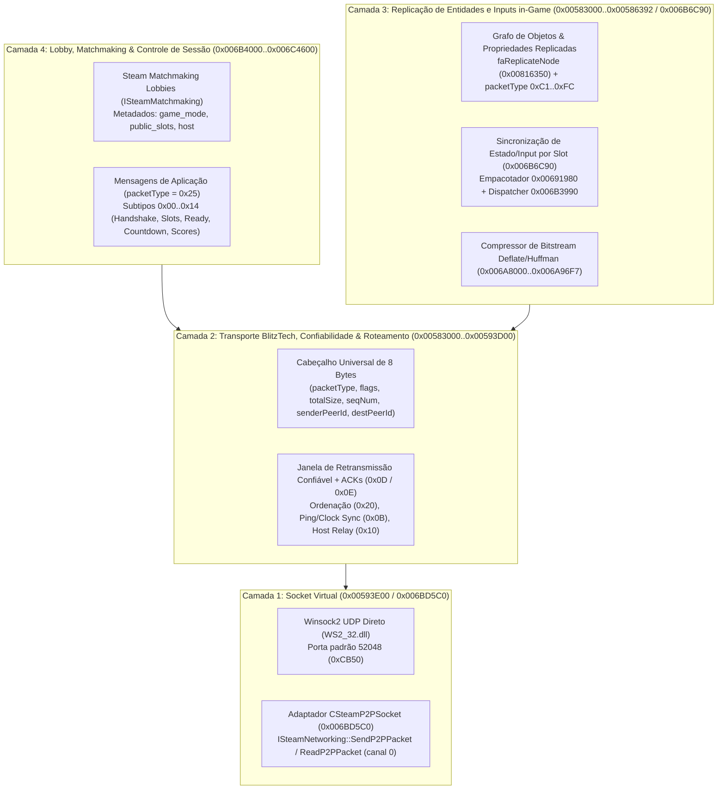

# Especificação do Protocolo de Rede e Replicação — Rotastic (`Rotastic.exe`)

> **Fonte primária:** Engenharia reversa estática completa dos subsistemas de transporte e rede da engine **BlitzTech (`FEngine`)** em [`Rotastic.exe`](reference/game-files/Rotastic.exe), extraída em [`Netcode_Steamworks.asm`](reference/decompiled/disasm/Netcode_Steamworks.asm), [`Netcode_TransportCore.asm`](reference/decompiled/disasm/Netcode_TransportCore.asm), [`Netcode_UDPSocket.asm`](reference/decompiled/disasm/Netcode_UDPSocket.asm), [`Netcode_Replication.asm`](reference/decompiled/disasm/Netcode_Replication.asm), [`Netcode_LobbyAndModes.asm`](reference/decompiled/disasm/Netcode_LobbyAndModes.asm) e catalogada em [`netcode-replication-spec.json`](reference/decompiled/netcode-replication-spec.json).

---

## 1. Visão Geral da Arquitetura de Rede (4 Camadas)

O multiplayer online de **Rotastic** opera em topologia **Client-Host (Star / Hub-and-Spoke)** para até **4 jogadores** (`peerId = 0` é sempre o **Host autoritativo da sessão**; `peerId = 1..3` são os clientes remotos; a estrutura de sessão suporta até 16 slots `0..15`).

A pilha de rede é dividida em **4 camadas independentes**:



---

## 2. Camada 1 — Adaptador de Socket Virtual (`UDP 52048` vs. `CSteamP2PSocket`)

A camada de transporte do BlitzTech (`0x00593E00..0x00594600` em [`Netcode_UDPSocket.asm`](reference/decompiled/disasm/Netcode_UDPSocket.asm)) suporta três modos de operação configurados nos campos da estrutura de sessão (`session` em `esi`):

1. **TCP (`[session + 0x04] == 0`):** Usa `socket(AF_INET, SOCK_STREAM, 0)`, `listen`, `accept`, `recv`, `send`. Não é usado em partidas do Rotastic.
2. **UDP Nativo LAN (`[session + 0x04] == 1`, sem bit `0x200` em `[session + 0x14]`):**
   - Abre socket `SOCK_DGRAM` não-bloqueante (`ioctlsocket(FIONBIO)`) e habilita `SO_BROADCAST`.
   - Porta padrão: **`52048` (`0xCB50`)**, inicializada no construtor da sessão em `0x00593E09` (`mov dword ptr [eax + 0x7c], 0xcb50`).
3. **Callback de Transporte Customizado (`[session + 0x14] & 0x200`) — Usado na versão Steam (`CSteamP2PSocket`):**
   - Quando o bit `0x200` está ativo (`test dword ptr [esi + 0x14], 0x200`), as funções de envio (`0x005944D6`) e recepção (`0x0059436A`) desviam das chamadas `sendto`/`recvfrom` da `WS2_32.dll` e invocam o objeto `CSteamP2PSocket` registrado em `[0x00B752BC]`.

### 2.1 Tunelamento `CSteamID` em `sockaddr_in` (`CSteamP2PSocket`, `0x006BD5C0..0x006BD9D7`)

Para reaproveitar toda a engine de rede BlitzTech baseada em `sockaddr_in` (16 bytes) sem reescrever o roteador de pacotes, o `CSteamP2PSocket` armazena o **`CSteamID` de 64 bits** nos últimos 8 bytes da estrutura `sockaddr_in` (`sin_zero[0..7]`, offsets `+0x08..+0x0F`):

| Offset | Tipo | Campo `sockaddr_in` | Uso em `CSteamP2PSocket` (`0x006BD6C0` / `0x006BD7A0`) |
| :--- | :--- | :--- | :--- |
| `+0x00` | `uint16_t` | `sin_family` | `AF_INET` (`2`) ou `0` |
| `+0x02` | `uint16_t` | `sin_port` | `htons(52048)` (`0x50CB`) |
| `+0x04` | `uint32_t` | `sin_addr` | IP virtual / zerado |
| `+0x08` | `uint64_t` | `sin_zero[0..7]` | **`CSteamID` de 64 bits (little-endian)** do peer remoto |

- **Envio (`CSteamP2PSocket::SendPacket` @ `0x006BD6C0`):**
  1. Extrai `steamIDRemote` de `[addr + 0x08]` (`mov ecx, [eax+8]; mov edx, [eax+0x0C]`).
  2. Chama `ISteamNetworking::SendP2PPacket(steamIDRemote, pubData, cubData, k_EP2PSendUnreliable = 0, nChannel = 0)`.
  3. **Detalhe crítico:** Todos os pacotes são enviados à Steamworks como `k_EP2PSendUnreliable (0)` no canal `0` (`push 0; push 0`), pois o próprio BlitzTech implementa confirmação (`ACK`), retransmissão e ordenação na Camada 2.
- **Recepção (`CSteamP2PSocket::ReceivePacket` @ `0x006BD7A0`):**
  1. Chama `ISteamNetworking::IsP2PPacketAvailable(&cubMsgSize, 0)`.
  2. Se disponível, lê via `ISteamNetworking::ReadP2PPacket(pubDest, cubDest, &cubMsgSize, &steamIDRemote, 0)`.
  3. Preenche `[outAddr + 0x08..0x0F] = steamIDRemote` e entrega o datagrama ao loop do BlitzTech (`0x00592170`).

---

## 3. Camada 2 — Framing BlitzTech, Confiabilidade, Ordenação e Sincronização de Relógio

### 3.1 Cabeçalho Universal de 8 Bytes (`0x0058CD50` / `0x0058CE90` / `0x0058DFB0`)

Todo pacote que trafega pela rede (seja de controle, lobby ou replicação) começa com exatamente **8 bytes** (`little-endian`):

```
 0                   1                   2                   3
 0 1 2 3 4 5 6 7 8 9 0 1 2 3 4 5 6 7 8 9 0 1 2 3 4 5 6 7 8 9 0 1
+-+-+-+-+-+-+-+-+-+-+-+-+-+-+-+-+-+-+-+-+-+-+-+-+-+-+-+-+-+-+-+-+
|  packetType   |     flags     |           totalSize           |
+-+-+-+-+-+-+-+-+-+-+-+-+-+-+-+-+-+-+-+-+-+-+-+-+-+-+-+-+-+-+-+-+
|            seqNum             | senderPeerId  |  destPeerId   |
+-+-+-+-+-+-+-+-+-+-+-+-+-+-+-+-+-+-+-+-+-+-+-+-+-+-+-+-+-+-+-+-+
|                        Payload (0..N B)                       |
+-+-+-+-+-+-+-+-+-+-+-+-+-+-+-+-+-+-+-+-+-+-+-+-+-+-+-+-+-+-+-+-+
```

| Offset | Tipo | Nome | Descrição |
| :--- | :--- | :--- | :--- |
| `+0x00` | `uint8_t` | `packetType` | Opcode do pacote (`0x00..0x27` = controle/sistema; `0x25` = mensagem de aplicação/lobby; `0xC1..0xFC` = replicação de objetos). |
| `+0x01` | `uint8_t` | `flags` | Bitmask de entrega e roteamento (ver Tabela 3.2). |
| `+0x02` | `uint16_t` | `totalSize` | Tamanho total do pacote em bytes (incluindo os 8 bytes de cabeçalho). |
| `+0x04` | `uint16_t` | `seqNum` | Número de sequência por par de peers (`1..0xFFFE`; `0` em pacotes de handshake sem sequência). |
| `+0x06` | `uint8_t` | `senderPeerId` | ID do remetente (`0` = Host, `1..15` = Cliente, `0xFE` = ainda sem slot atribuído). |
| `+0x07` | `uint8_t` | `destPeerId` | ID do destinatário (`0` = Host, `1..15` = Cliente específico, `0xFF` = Broadcast para todos os peers). |

### 3.2 Bits do Campo `flags` (`+0x01`)

Analisados em `0x0058DFB0` (envio) e `0x0058E8C0` / `0x00592170` (recepção):

| Máscara | Nome | Comportamento no Código Nativo |
| :--- | :--- | :--- |
| `0x00` | `UNRELIABLE_UNORDERED` | Incrementa `outUnreliableSeq` (`[peerChan + 0x0A]`, ciclo `1..0xFFFE`). Se chegar fora de ordem mas mais recente que `lastUnreliableSeq` (`[peerChan + 0x08]`), atualiza o contador e entrega imediatamente (`0x0058EE8C`). |
| `0x02` | `RELIABLE` (`NEEDS_ACK`) | Armazena cópia do pacote na fila de retransmissão (`[peerChan + 0x14]`, `0x0058E17D`) e exige `ACK` (`packetType = 0x0D` ou `0x0E`). |
| `0x08` | `LOCAL_LOOPBACK` | Evento interno sintetizado localmente para a fila de eventos da sessão (`0x0058DEC0`). |
| `0x10` | `HOST_RELAYED` | Marcado pelo Host (`or byte ptr [edi + 1], 0x10` em `0x005924B6`) ao retransmitir um pacote enviado por um cliente com `destPeerId == 0xFF` (broadcast) ou `destPeerId != 0` (peer-to-peer via Host). |
| `0x20` | `ORDERED` | Exige entrega estritamente em ordem (`seqNum == expectedInReliableSeq + 1`). Se `seqNum` for maior que o esperado, o pacote é inserido na fila de reordenação (`0x00B49F18`, até `0x00B4A018` slots) e entregue assim que as lacunas anteriores chegarem (`0x0058EC40..0x0058EE80`). |
| `0x22` | `RELIABLE_ORDERED` (`0x20 \| 0x02`) | Combinação padrão usada por todas as mensagens de lobby/controle (`0x25`) e eventos críticos de sessão. Usa o contador `outReliableSeq` (`[peerChan + 0x0E]`, ciclo `1..0xFFFE`). |

### 3.3 Tabela Completa de Opcodes da Camada de Transporte (`packetType` `0x00..0x27`)

Extraída dos dispatchers do Cliente (`0x005834B0..0x00583C90`), Comum (`0x0058C500..0x0058CC90`) e Host (`0x00591C60..0x00592680`):

| `packetType` | Nome | Direção | Tamanho | Estrutura do Payload (após byte `+0x07`) | Função Handler |
| :--- | :--- | :--- | :--- | :--- | :--- |
| `0x00` | `LAN_DISCOVERY_PING` | Broadcast | `16 B` (`0x10`) | `+0x08: uint32 sessionToken`, `+0x0C: uint32 flags` | `0x00591070` |
| `0x01` | `LAN_DISCOVERY_PONG` | Host → Cliente | `104 B` (`0x68`) | `+0x08: uint32 token`, `+0x0C..+0x27: stats`, `+0x28..+0x67: char[64] sessionName` | `0x00591105` / `0x0058CD09` |
| `0x03` | `CONNECT_REQUEST` | Cliente → Host | `16 B` (`0x10`) | `+0x08: uint32 protocolVersion`, `+0x0C: uint32 joinToken` | Envio: `0x005834C0` / Host: `0x00591C80` |
| `0x04` | `CONNECT_ACCEPT` | Host → Cliente | `16 B` (`0x10`) | `+0x08: uint8 assignedPeerId`, `+0x09: uint8 hostPeerId (0)`, `+0x0A: uint16 maxPeers`, `+0x0C: uint32 sessionFlags` | Host: `0x005913B0` / Cliente: `0x00583560` |
| `0x06` | `CONNECT_REJECT` | Host → Cliente | `8 B` (`0x08`) | Sem payload (sessão cheia ou inválida) | `0x00591363` / `0x00591D1B` |
| `0x08` | `PEER_CONNECTED_LOCAL` | Interno / Host | `12 B` (`0x0C`) | `+0x08: uint32 peerId` | `0x00583740` |
| `0x09` | `PEER_DISCONNECTED` | Bidirecional | `16 B` (`0x10`) | `+0x08: uint8 flags`, `+0x09: uint8 peerId`, `+0x0A: uint8 oldState`, `+0x0C: uint32 disconnectReason` (`1`=local, `2`=timeout, `3`=kicked) | `0x0058C3B8` / `0x0058C9BC` / `0x0058CABD` |
| `0x0A` | `KEEPALIVE_PROBE` | Cliente ↔ Host | `40 B` (`0x28`) | Sonda de inatividade enviada quando o peer fica sem tráfego por `timeout/2` | `0x0058C52B` |
| `0x0B` | `PING_CLOCK_SYNC` | Cliente ↔ Host | `20 B` (`0x14`) ou `36 B` (`0x24`) | **Req (Cliente→Host, `0x14 B`):** `+0x08: uint32 clientSendMs`, `+0x0C: uint32 hostTimeEcho`, `+0x10: uint32 lastRtt`<br>**Resp (Host→Cliente, `0x14` ou `0x24 B`):** `+0x08: uint32 clientSendMs`, `+0x0C: uint32 hostCurrentMs`, `+0x10: uint32 seq`, `+0x14..+0x23: uint8[16] compressedPeerRtts` | Req: `0x0058C568`<br>Host: `0x00591F50`<br>Cliente: `0x005837C0` |
| `0x0D` | `TRANSPORT_ACK` | Bidirecional | `10 B` ou `12 + 2*N B` | `+0x08: uint16 ackedSeq`, `+0x0A: uint8 ackFlags`, `+0x0B: uint8 extraAckCount (N)`, `+0x0C: uint16[N] extraAckedSeqs` | Envio: `0x0058E710`<br>Rx: `0x0058E440` |
| `0x0E` | `TRANSPORT_SACK` | Bidirecional | `12 + 2*N B` | Confirmação seletiva em lote de pacotes fora de ordem (`+0x0B: count`) | Envio: `0x0058E7F9`<br>Rx: `0x0058E440` |
| `0x0F` | `PEER_JOINED_ANNOUNCE` | Host → Todos | `28 B` (`0x1C`) | `+0x08: uint8 newPeerId`, `+0x0C..+0x1B: sockaddr_in` (com `CSteamID` em `+0x14..+0x1B`) | Host: `0x00591742`<br>Cliente: `0x005836B0` |
| `0x10` | `PEER_TABLE_SYNC` | Host → Novo Peer | `12 + 20*N B` | `+0x08: uint32 peerCount (N)`, seguido de `N` registros de `20 B`: `[uint8 peerId, 3B pad, 16B sockaddr_in/CSteamID]` | Host: `0x00591841`<br>Cliente: `0x005835E0` |
| `0x1B` | `DATABLOCK_SYNC` | Host → Clientes | `16 B` (`0x10`) | Sincronização de bloco compartilhado (`blockId` em `+0x09`) | `0x00583930` / `0x0058C650` |
| `0x1C` | `DATABLOCK_LOCK_REQ` | Cliente ↔ Host | `16 B` (`0x10`) | Solicitação/confirmação de trava de bloco distribuído | `0x00583A70` / `0x0058C750` |
| `0x1F` | `DATABLOCK_UNLOCK` | Cliente ↔ Host | `16 B` (`0x10`) | Liberação de trava de bloco distribuído | `0x00583AF0` / `0x0058C7E0` |
| `0x20` | `DATABLOCK_UPDATE` | Cliente ↔ Host | `16+ B` | Atualização de conteúdo de bloco distribuído | `0x00583B90` / `0x0058C870` |
| `0x25` | `APP_CONTROL_MESSAGE` | Bidirecional | `12+ B` | Mensagem da camada de aplicação/lobby do Rotastic (`+0x08: uint32 subType`, ver Seção 5) | Callback `0x006BC6B0` |
| `0x26` | `SESSION_CLOSED` | Host → Todos | `8 B` (`0x08`) | Encerramento gracioso da sessão pelo Host | `0x0058BEAE` |
| `0x27` | `SESSION_LOCKED` | Host → Cliente | `8 B` (`0x08`) | Partida já iniciada / sessão trancada para novos peers | `0x00591D76` |

### 3.4 Sincronização de Relógio e Tabela de Ping (`packetType = 0x0B`)

No handler `0x005837C0`:
1. O cliente calcula o **RTT instantâneo**:
   $$\text{RTT} = \text{timeGetTime}() - \text{pkt.clientSendMs}$$
2. Atualiza a média móvel de RTT em `[session + 0xDC]` e calcula o **offset de relógio em relação ao Host** em `[session + 0xD4]`:
   $$\text{clockOffset} = \text{pkt.hostCurrentMs} - \left(\text{timeGetTime}() - \frac{\text{RTT}}{2}\right)$$
3. Quando a flag `0x80000` está ativa em `[session + 0x14]`, o Host anexa **16 bytes** (`+0x14..+0x23`) contendo o RTT comprimido de cada um dos 16 slots de peers (codificado via `0x0058D3E0` e decodificado no cliente via `0x0058D440`), permitindo que todos os clientes exibam barras de ping de todos os jogadores na sala mesmo em topologia estrela.

---

## 4. Camada 3 — Engine de Replicação de Entidades e Estado in-Game (`0xC1..0xFC`)

Durante a partida, a sincronização de gameplay combina **dois mecanismos complementares**:

### 4.1 Sincronização de Estado/Inputs de Jogadores por Slot (`0x006B6C90`)

A função `0x006B6C90` (chamada a cada passo de rede pelo gerenciador de partida `[0x00B752C8]`) sincroniza os slots de jogadores ativos:
1. Percorre os até 16 slots da sessão (array em `[0x00B752C8] + 0x2B8`, stride `0x124 = 292 bytes` por jogador).
2. Para cada jogador presente (`[slot + 0x08] != 0`), chama `0x00691980` passando o estado local (`[slot + 0x34C]`) e o buffer de serialização (`[slot + 0x2CC]`), retornando uma máscara de bits de campos alterados (`dirtyMask`).
3. Agrupa os ponteiros dos buffers sujos em um vetor na pilha e invoca o despachante de replicação `0x006B3990(channel = 6, flags, playerCount, bufferPtrs, ...)`.
4. No receptor (`0x006BC400` para Host via `0x0058A280`; `0x006BC470` para Cliente via `0x0058A3B0`), os pacotes recebidos atualizam os slots remotos para o passo de simulação.

### 4.2 Grafo de Objetos e Propriedades Replicadas (`faReplicateNode` & `0x00583000..0x00586392`)

A action de grafo **`faReplicateNode`** (`vtable 0x0093E3C8`, construtor `0x008456A0`, execução `0x00816350`) conecta nós de cena/entidades (`fneNode`) ao contexto global de replicação `[0x00B4A048]`:

- **Atributos de `faReplicateNode` (`0x00845390`):**
  - `ReplicatingNode` (evento de entrada que ativa a replicação do nó)
  - `ReplicatedNode` (evento disparado quando o nó remoto é atualizado)
  - `ReplicatingProp0` .. `ReplicatingProp7` (até **8 propriedades replicadas** por nó, registradas nos offsets `+0x34..+0x50` da action)
- **Serialização de Propriedades (`0x0058305E..0x0058345F` e `0x005861F0..0x00586392`):**
  - Cada objeto replicado recebe um `objectSlotId` de 1 byte e mantém uma lista encadeada de propriedades (`0x005861F0`).
  - Cada propriedade possui:
    - `+0x0C` (`uint32_t`): `typeId` (`0..15`), despachado pela jump table `0x00586398`:
      - `0, 1`: `int8 / uint8` (1 byte)
      - `2, 3`: `int16 / uint16` (2 bytes)
      - `4, 5, 6`: `int32 / uint32 / float32` (4 bytes)
      - `7`: `float64 / uint64` (8 bytes)
      - `8`: `Vector2` (8 bytes)
      - `9`: `Vector3` (12 bytes)
      - `10`: `Vector4 / Quaternion` (16 bytes)
      - `11`: `Matrix4x4` (64 bytes)
      - `12`: `String / Buffer` (tamanho variável prefixado)
    - `+0x10` (`uint8_t`): `propId` (índice da propriedade no objeto)
    - `+0x12` (`uint8_t`): `flags` (`bit 0` = `dirty` / alterada desde o último snapshot)
    - `+0x1C` (`uint32_t`): `minUpdateIntervalMs` (intervalo mínimo entre envios da propriedade)
- **Opcodes de Pacote de Replicação (`0xC1..0xFC`):**
  - Na recepção (`0x00591BEA` no Host e `0x0059234B` no Cliente), qualquer pacote cujo byte `+0x00` (`packetType`) esteja no intervalo **`0xC1..0xFC`** (`193..252`) é separado do fluxo de controle e entregue diretamente ao motor de replicação (`[0x00B4A048]`).
  - O bitstream de replicação utiliza opcionalmente o compressor **Deflate/Huffman customizado** em `0x006A8000..0x006A96F7` (com tabelas de códigos de comprimento fixo/dinâmico em `0x00931E88` e `0x00931EB0`).

---

## 5. Camada 4 — Protocolo de Aplicação, Lobby e Partida (`packetType = 0x25`)

Todas as mensagens de coordenação de lobby, slots de jogadores, seleção de personagem/mapa, contagem regressiva e placar final utilizam `packetType = 0x25` (`37`) com `flags = 0x22` (`RELIABLE_ORDERED`), gerenciadas pelo singleton de sessão online `[0x00B752C8]`.

### 5.1 Cabeçalho de Mensagem de Aplicação (`12 bytes`)

| Offset | Tipo | Campo | Descrição |
| :--- | :--- | :--- | :--- |
| `+0x00..+0x07` | `8 bytes` | `transportHeader` | Cabeçalho BlitzTech com `packetType = 0x25`, `flags = 0x22`, `totalSize`, `seqNum`, `senderPeerId`, `destPeerId`. |
| `+0x08..+0x0B` | `uint32_t` | `msgSubType` | Subtipo da mensagem de aplicação (`0x00..0x14`, little-endian). |
| `+0x0C..` | `variável` | `payload` | Dados específicos do subtipo (ver Tabela 5.2). |

### 5.2 Catálogo Completo de Subtipos (`msgSubType` `0x00..0x14`)

Extraído dos construtores de pacote (`0x006B72A0..0x006B7FB0`) e dos dois grandes `switch` handlers:
- **Handler do Host (`0x006B8030` com jump table em `0x006B8400`):** processa mensagens enviadas pelos Clientes (`subTypes` `0x00`, `0x05`, `0x0D`, `0x13`).
- **Handler do Cliente (`0x006B8420` com jump table em `0x006B8B50`):** processa mensagens enviadas pelo Host (`subTypes` `0x01`, `0x02`, `0x06`, `0x07`, `0x0E`, `0x14`).

| `msgSubType` | Nome | Direção | Tamanho Total | Layout Exato do Payload (offsets a partir do início do pacote) | Função Emissora / Handler |
| :--- | :--- | :--- | :--- | :--- | :--- |
| `0x00` (`0`) | `CLIENT_JOIN_HANDSHAKE` | Cliente → Host | `24 B` (`0x18`) | `+0x08: uint32 subType (0)`<br>`+0x0C: uint32 localPlayerCount`<br>`+0x10: uint64 clientSteamID` | Envio: `0x006B72A0`<br>Host Rx: `0x006B806B` |
| `0x01` (`1`) | `HOST_JOIN_DECISION` | Host → Cliente | `20 B` (`0x14`) | `+0x08: uint32 subType (1)`<br>`+0x0C: uint32 acceptedFlag` (`1` = aceito, `0` = recusado)<br>`+0x10: uint32 assignedBaseSlot` | Envio: `0x006B81A3` / `0x006B81EE`<br>Cliente Rx: `0x006B845B` |
| `0x02` (`2`) | `LOBBY_FULL_STATE_SYNC` | Host → Todos (`0xFF`) | Variável (`16 + 292*N + M B`) | `+0x08: uint32 subType (2)`<br>`+0x0C: uint32 activeSlotCount (N)`<br>`+0x10: PlayerSlotData[N]` (`0x124 = 292 B` por slot ativo: `steamID`, `peerId`, `team`, `characterId`, `readyState`, `name[32]`, etc.)<br>Seguido do blob de configuração de partida (`0x006B6F70`: modo, mapa, meta de pontos, tempo) | Envio: `0x006B7370`<br>Cliente Rx: `0x006B84B8` |
| `0x05` (`5`) | `CLIENT_SLOT_UPDATE_REQ` | Cliente → Host | `40 B` (`0x28`) | `+0x08: uint32 subType (5)`<br>`+0x0C: uint32 playerSlotIndex`<br>`+0x10..+0x27: uint8[24] slotParams` (personagem, cor/time, estado ready, input local) | Envio: `0x006B74E0`<br>Host Rx: `0x006B821A` |
| `0x06` (`6`) | `HOST_SLOT_UPDATE_BROADCAST` | Host → Todos (`0xFF`) | `40 B` (`0x28`) | `+0x08: uint32 subType (6)`<br>`+0x0C: uint32 playerSlotIndex`<br>`+0x10..+0x27: uint8[24] validatedSlotParams` | Envio: `0x006B75D0`<br>Cliente Rx: `0x006B8595` |
| `0x07` (`7`) | `HOST_MATCH_CONFIG_SYNC` | Host → Todos (`0xFF`) | `12 + M B` | `+0x08: uint32 subType (7)`<br>`+0x0C..: MatchConfigBlob` serializado por `0x006B6F70` e lido por `0x006B7080` (modo de jogo, ID do mapa, limite de joias/abates, duração) | Envio: `0x006B77C0`<br>Cliente Rx: `0x006B862A` |
| `0x0D` (`13`) | `CLIENT_READY_PHASE_ACK` | Cliente → Host | `16 B` (`0x10`) | `+0x08: uint32 subType (13)`<br>`+0x0C: uint32 phaseCode`:<br>• `0`: Pronto no lobby (`readyMask1` em `[session + 0x1680]`)<br>• `1`: Mapa carregado / pronto para iniciar partida (`readyMask2` em `[session + 0x1684]`)<br>• `2`: Fim de partida confirmado (`readyMask3` em `[session + 0x1688]`) | Envio: `0x006B78D0`<br>Host Rx: `0x006B828F` |
| `0x0E` (`14`) | `HOST_PHASE_ADVANCE_CMD` | Host → Todos (`0xFF`) | `16 B` (`0x10`) | `+0x08: uint32 subType (14)`<br>`+0x0C: uint32 targetPhase`:<br>• `0`: Travar lobby e iniciar contagem regressiva (`state -> 0x7A`)<br>• `1`: Todos carregaram o nível — iniciar simulação da partida (`state -> 0x99`)<br>• `2`: Encerrar partida e retornar ao lobby / placar (`state -> 0xB8`) | Envio: `0x006B7990`<br>Cliente Rx: `0x006B8683` |
| `0x13` (`19`) | `CLIENT_RESULTS_REPORT` | Cliente → Host | `136 B` (`0x88`) | `+0x08: uint32 subType (19)`<br>`+0x0C: uint32 slotCount (até 4)`<br>`+0x10..+0x87: uint8[120]` (`4 × 30 B` de estatísticas/pontuações locais da partida por slot) | Envio: `0x006B7A50`<br>Host Rx: `0x006B8341` |
| `0x14` (`20`) | `HOST_FINAL_STANDINGS` | Host → Todos (`0xFF`) | `528 B` (`0x210`) | `+0x08: uint32 subType (20)`<br>`+0x0C: uint32 totalPlayers (até 16)`<br>`+0x10..+0x20F: uint8[512]` (`16 × 32 B` contendo classificação final, pontos, abates, mortes e medalhas de cada slot) | Envio: `0x006B7D00`<br>Cliente Rx: `0x006B88D1` |

---

## 6. Integração com Steam Matchmaking & Leaderboards (`0x006BA000..0x006C4500`)

Além dos pacotes P2P, a descoberta de salas usa `ISteamMatchmaking`:

### 6.1 Metadados de Lobby Steam (`SetLobbyData` / `AddRequestLobbyListNumericalFilter`)

Extraídos de `0x006BA0D0..0x006BA480` e `0x006BE490`:

| Chave de Lobby (`char*`) | Endereço VA | Tipo | Uso |
| :--- | :--- | :--- | :--- |
| `"game_mode"` | `0x0095B34C` | Numérico (`"%d"`) | Filtro de busca (`ELobbyComparisonEqual = 0`) em `AddRequestLobbyListNumericalFilter` (`0x006BA127`) e atributo de sala em `SetLobbyData` (`0x006BE50E`). |
| `"public_slots"` | `0x0095B340` | Numérico (`"%d"`) | Filtro de vagas disponíveis (`ELobbyComparisonEqualToOrLessThan` / `GreaterThan`) em `0x006BA159` e atualizado em `0x006BE545`. |
| `"host"` | `0x0095B358` | String | Nome/identificador do Host gravado via `SetLobbyData` ao criar a sala (`0x006BA39E`). |

### 6.2 Callbacks Steamworks Registrados pelo Jogo

| `iCallback` ID | Nome da Estrutura Steamworks | Handler VA | Propósito |
| :--- | :--- | :--- | :--- |
| `504` (`0x01F8`) | `LobbyEnter_t` | `0x006BA2A0` | Confirma entrada em um lobby Steam (`m_ulSteamIDLobby`, `m_EChatRoomEnterResponse`). |
| `505` (`0x01F9`) | `LobbyDataUpdate_t` | `0x006BD560` | Notifica atualização de metadados (`game_mode`, `public_slots`, `host`). |
| `507` (`0x01FB`) | `LobbyChatUpdate_t` | `0x006BD2B0` | Detecta entrada/saída/queda de membros no lobby (`m_rgfChatMemberStateChange`). |
| `510` (`0x01FE`) | `LobbyMatchList_t` | `0x006BA200` | Recebe a lista de lobbies encontrados no QuickMatch / Custom Match (`m_nLobbiesMatching`). |
| `337` (`0x0151`) | `GameLobbyJoinRequested_t` | `0x006BD4E0` | Convite de amigo aceito via Steam Overlay (`+connect_lobby <id>` em `0x0095B378`). |
| `1202` (`0x04B2`) | `P2PSessionRequest_t` | `0x006BD990` | Aceita automaticamente conexões P2P de membros válidos via `ISteamNetworking::AcceptP2PSessionWithUser`. |
| `1203` (`0x04B3`) | `P2PSessionConnectFail_t` | `0x006BD9B0` | Registra falha de transporte P2P (`m_eP2PSessionError`) e dispara desconexão do peer. |
| `1104` (`0x0450`) | `LeaderboardFindResult_t` | `0x006C1F50` | Resolução de handle de Leaderboard (`LEVEL_%02d`, `SUPER_ROTASTIC`, `SURVIVAL_ROTASTIC`, `CHAMPION_ROTASTIC`). |
| `1105` (`0x0451`) | `LeaderboardScoresDownloaded_t` | `0x006C1FC0` | Recepção de entradas de ranking via `GetDownloadedLeaderboardEntry`. |
| `1106` (`0x0452`) | `LeaderboardScoreUploaded_t` | `0x006C2050` | Confirmação de envio de pontuação (`UploadLeaderboardScore`). |

---

## 7. Mapeamento Direto para o Protocolo Web (Fase 4)

Na reimplementação Web (Cliente Browser + Servidor Autoritativo Node.js):

1. **Substituição da Camada 1 + Topologia Estrela:**
   - Em vez de clientes tunelarem pacotes P2P para um jogador Host via `ISteamNetworking`, o **Servidor Node.js atua sempre como o `peerId = 0` (Host autoritativo)** sobre **WebSocket** (ou WebRTC DataChannel opcional).
   - Isso elimina problemas de NAT traversal, host migration e vantagem de latência zero do Host.
2. **Simplificação da Camada 2:**
   - Mensagens de controle (`packetType = 0x25`, subtipos `0x00..0x14`) trafegam em canal confiável ordenado nativo do WebSocket.
   - Snapshots de simulação (`60 Hz` física / `20..30 Hz` rede) usam frames binários compactos com `seqNum` monotônico (`uint16_t`) e cálculo de `clockOffset` + RTT idêntico ao `packetType = 0x0B`.
3. **Fidelidade nas Camadas 3 e 4:**
   - As 3 barreiras de sincronização (`phaseCode = 0` Lobby Ready, `phaseCode = 1` Map Loaded, `phaseCode = 2` Match End Ack) dos subtipos `0x0D` / `0x0E` e os payloads de configuração (`0x02`, `0x05`, `0x06`, `0x07`, `0x13`, `0x14`) serão preservados 1:1 no schema compartilhado em `packages/protocol`.
