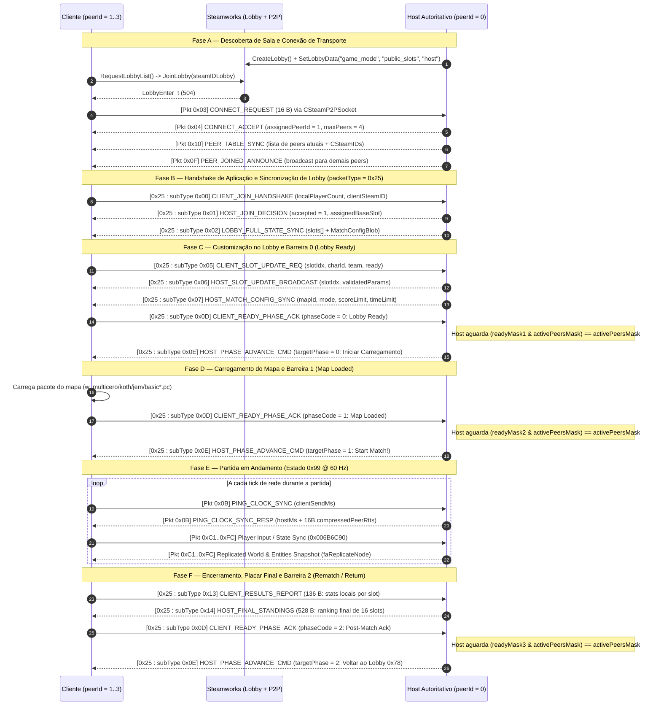

# Máquina de Estados de Sessão, Lobby e Partida — Rotastic (`Rotastic.exe`)

> **Fonte primária:** Engenharia reversa da máquina de estados online principal em [`Netcode_Steamworks.asm`](file:///c:/Users/rafae/Documents/Coding/Vibecoding/Decompilation/rotastic/reference/decompiled/disasm/Netcode_Steamworks.asm) (`0x006BA4E0..0x006BC070`), handlers de mensagens de aplicação (`0x006B8030..0x006B8B70`), e FlowActions de ciclo de vida online em [`Netcode_LobbyAndModes.asm`](file:///c:/Users/rafae/Documents/Coding/Vibecoding/Decompilation/rotastic/reference/decompiled/disasm/Netcode_LobbyAndModes.asm) (`0x004F4500..0x004FC500`).

---

## 1. Visão Geral da Máquina de Estados Online (`[session + 0x08]`)

O singleton gerenciador de sessão online (`[0x00B752C8]`, alocado com `0x16C8 = 5832 bytes`) mantém o estado mestre da sessão em `[session + 0x08]` e executa a função de tick **`OnlineSession_UpdateStateMachine` (`0x006BA4E0`)** a cada quadro.

Os estados são organizados em **5 faixas numéricas** (`hex`):

| Faixa de Estado (`[session + 0x08]`) | Subsistema | Papel Principal |
| :--- | :--- | :--- |
| **`0x01`** | `IDLE` | Sessão inativa / modo offline. |
| **`0x0B .. 0x20`** (`11..32`) | **QuickMatch / Matchmaking Search** | Busca lobbies compatíveis (`RequestLobbyList`), tenta entrar em cada candidato (`JoinLobby`) e faz fallback para criação de sala se nenhum responder. |
| **`0x21 .. 0x44`** (`33..68`) | **Join Direto / Convite Steam** | Entrada em lobby específico (`+connect_lobby` ou convite de amigo `GameLobbyJoinRequested_t`), handshake BlitzTech (`0x03`/`0x04`) e handshake de aplicação (`0x25:0x00`/`0x01`). |
| **`0x72 .. 0xC0`** (`114..192`) | **Ciclo Completo de Lobby e Partida (Host & Cliente)** | Criação de sala, gerenciamento de slots (`0x02`, `0x05`, `0x06`, `0x07`), 3 barreiras de prontidão (`0x0D`/`0x0E`), carregamento de mapa, partida ativa (`0x99`) e placar final (`0x13`/`0x14`). |
| **`0xDA .. 0xDB`** (`218..219`) | **Teardown / Desconexão** | Fechamento de socket P2P (`0x006BC5C0`), saída do lobby Steam (`LeaveLobby`) e limpeza de slots. |

---

## 2. Diagrama de Estados Completo (`stateDiagram-v2`)

```mermaid
stateDiagram-v2
    [*] --> Idle_0x01

    state "1. Busca QuickMatch (0x0B..0x20)" as QuickMatch {
        State_0x0B_InitSearch : 0x0B Init QuickMatch Filter\n(RequestLobbyList: game_mode, public_slots)
        State_0x0C_WaitList : 0x0C Wait LobbyMatchList_t (510)
        State_0x15_TryCandidate : 0x15 Try Join Candidate Lobby [i]
        State_0x16_WaitEnter : 0x16 Wait LobbyEnter_t (504)
        State_0x17_NextOrFallback : 0x17 Next Candidate or Host Fallback

        State_0x0B_InitSearch --> State_0x0C_WaitList
        State_0x0C_WaitList --> State_0x15_TryCandidate : Lobbies > 0
        State_0x0C_WaitList --> State_0x72_CreateLobby : 0 Lobbies Found
        State_0x15_TryCandidate --> State_0x16_WaitEnter
        State_0x16_WaitEnter --> State_0x2A_TransportConnect : Enter OK
        State_0x16_WaitEnter --> State_0x17_NextOrFallback : Enter Failed
        State_0x17_NextOrFallback --> State_0x15_TryCandidate : More Candidates
        State_0x17_NextOrFallback --> State_0x72_CreateLobby : Exhausted
    }

    state "2. Handshake de Entrada do Cliente (0x21..0x44)" as ClientJoin {
        State_0x21_DirectJoin : 0x21 Join Lobby by SteamID
        State_0x2A_TransportConnect : 0x2A BlitzTech P2P Connect\n(pkt 0x03 -> 0x04, Timeout 15.0s)
        State_0x2B_SendAppJoin : 0x2B Send CLIENT_JOIN_HANDSHAKE\n(pkt 0x25 subType 0x00)
        State_0x2C_WaitJoinDecision : 0x2C Wait HOST_JOIN_DECISION (subType 0x01)\n& LOBBY_FULL_STATE_SYNC (subType 0x02)

        State_0x21_DirectJoin --> State_0x2A_TransportConnect
        State_0x2A_TransportConnect --> State_0x2B_SendAppJoin : P2P Connected
        State_0x2B_SendAppJoin --> State_0x2C_WaitJoinDecision
    }

    state "3. Lobby, Partida & Pós-Jogo (0x72..0xC0)" as MatchLoop {
        State_0x72_CreateLobby : 0x72 Host CreateLobby (ISteamMatchmaking)
        State_0x73_WaitCreated : 0x73 SetLobbyData (game_mode, public_slots, host)\n& Init Host P2P Session (0x006BC210)
        State_0x78_LobbyOpen : 0x78 Lobby Aberto (Seleção de Personagem/Cor/Time)\nSync: subTypes 0x02, 0x05, 0x06, 0x07
        State_0x7A_Countdown : 0x7A Lobby Locked / Contagem Regressiva\n(Wait readyMask1 @ +0x1680 via subType 0x0D/0x0E phase=0)
        State_0x8F_LoadingMap : 0x8F Carregando Mapa Multiplayer\n(Wait readyMask2 @ +0x1684 via subType 0x0D/0x0E phase=1)
        State_0x99_InGame : 0x99 Partida em Andamento (Simulação 60 Hz)\n(Replicação 0xC1..0xFC + Input Sync 0x006B6C90)
        State_0xA8_ReportResults : 0xA8 Fim da Partida / Coleta de Scores\n(Clientes enviam subType 0x13; Host difunde subType 0x14)
        State_0xB8_PostMatchAck : 0xB8 Pódio / Placar Final\n(Wait readyMask3 @ +0x1688 via subType 0x0D/0x0E phase=2)

        State_0x72_CreateLobby --> State_0x73_WaitCreated
        State_0x73_WaitCreated --> State_0x78_LobbyOpen
        State_0x78_LobbyOpen --> State_0x7A_Countdown : Host Starts / All Ready
        State_0x7A_Countdown --> State_0x8F_LoadingMap : subType 0x0E (phase=0)
        State_0x8F_LoadingMap --> State_0x99_InGame : All Peers Loaded (subType 0x0E phase=1)
        State_0x99_InGame --> State_0xA8_ReportResults : Time/Score Goal or Sudden Death Win
        State_0xA8_ReportResults --> State_0xB8_PostMatchAck : Standings Broadcast (subType 0x14)
        State_0xB8_PostMatchAck --> State_0x78_LobbyOpen : Rematch / Return to Lobby (subType 0x0E phase=2)
    }

    state "4. Teardown & Erro (0xDA..0xDB)" as Teardown {
        State_0xDA_Closing : 0xDA Close BlitzTech Session (pkt 0x26 / 0x09)\n& LeaveSteamLobby
        State_0xDB_Cleanup : 0xDB Reset All Player Slots & Return to Menu
        State_0xDA_Closing --> State_0xDB_Cleanup
    }

    Idle_0x01 --> State_0x0B_InitSearch : QuickMatch
    Idle_0x01 --> State_0x21_DirectJoin : Join Invite / Custom
    Idle_0x01 --> State_0x72_CreateLobby : Create Host Match
    State_0x2C_WaitJoinDecision --> State_0x78_LobbyOpen : Accepted (subType 0x01 == 1)
    State_0x2C_WaitJoinDecision --> State_0xDA_Closing : Rejected / Timeout (15.0s)
    MatchLoop --> State_0xDA_Closing : Host Drop / User Quit
    State_0xDB_Cleanup --> Idle_0x01
```

---

## 3. Sequência Completa de Mensagens (Handshake → Lobby → Partida → Pódio)

---

## 4. Mecanismo das 3 Barreiras de Sincronização (`readyMask1..3`)

Em `0x006B828F` (handler do Host para `msgSubType = 0x0D`) e `0x006BA4E0` (máquina de estados), o Host coordena transições coletivas usando **3 bitmasks de 32 bits** onde cada bit `(1 << peerId)` representa um peer conectado:

| Barreira | Offset na Sessão (`[0x00B752C8]`) | `phaseCode` (`0x0D` / `0x0E`) | Condição de Disparo no Host | Transição Resultante |
| :--- | :--- | :--- | :--- | :--- |
| **Barreira 0 (Lobby Lock)** | `+0x1680` (`readyMask1`) | `0` | `(readyMask1 & activePeerMask) == activePeerMask` | Host envia `0x0E (phase=0)` e avança de `0x7A` para `0x8F` (carregamento do nível). |
| **Barreira 1 (Level Loaded)** | `+0x1684` (`readyMask2`) | `1` | `(readyMask2 & activePeerMask) == activePeerMask` | Host envia `0x0E (phase=1)` e avança todos os peers simultaneamente de `0x8F` para `0x99` (início da partida). |
| **Barreira 2 (Post-Match)** | `+0x1688` (`readyMask3`) | `2` | `(readyMask3 & activePeerMask) == activePeerMask` | Host envia `0x0E (phase=2)` e retorna todos os peers de `0xB8` para `0x78` (lobby aberto para próxima partida). |

> **Detalhe importante para desconexões durante barreiras:** Quando um peer desconecta (`0x006B8B70` / `0x006BC630`), seu bit é removido de `activePeerMask` (`[session + 0x167C]`), destravando imediatamente qualquer barreira que estivesse aguardando apenas aquele jogador.

---

## 5. Temporizadores e Timeouts de Rede Extraídos do Binário

Extraídos das constantes IEEE-754 em `.rdata` referenciadas por `0x006BA4E0..0x006BC070`:

| Constante | Endereço VA | Valor | Uso na Máquina de Estados |
| :--- | :--- | :--- | :--- |
| `HANDSHAKE_AND_JOIN_TIMEOUT` | `0x0099B748` | **`15.0 s`** (`double`) | Tempo máximo para completar `CONNECT_REQUEST` (`0x2A`) ou `CLIENT_JOIN_HANDSHAKE` (`0x2C`) antes de abortar para `0xDA`. |
| `LOBBY_READY_BARRIER_TIMEOUT` | `0x0099B750` | **`25.0 s`** (`double`) | Tempo máximo de espera nas barreiras de sincronização (`0x7A`, `0x8F`, `0xB8`) antes de forçar avanço ou desconectar peers inativos. |
| `LOBBY_SEARCH_RETRY_DELAY` | `0x0099B740` | **`2.0 s`** (`double`) | Intervalo entre tentativas/etapas de busca no QuickMatch (`0x0B..0x17`). |
| `KEEPALIVE_INTERVAL` | `0x0058C510` | **`timeout / 2`** | Intervalo de envio de `KEEPALIVE_PROBE` (`packetType = 0x0A`) e `PING_CLOCK_SYNC` (`0x0B`). |

---

## 6. Catálogo de FlowActions de Rede e Lobby (`0x004F4500..0x004FC500`)

As cenas de interface (FEUI / FUI) do jogo controlam a máquina de estados acima invocando **19 FlowActions dedicadas** registradas no grafo do BlitzTech (extraídas em [`Netcode_LobbyAndModes.asm`](file:///c:/Users/rafae/Documents/Coding/Vibecoding/Decompilation/rotastic/reference/decompiled/disasm/Netcode_LobbyAndModes.asm)):

| FlowAction | Execute VA | Papel na Máquina de Estados |
| :--- | :--- | :--- |
| `faFrameworkOnlineQuickMatch` | `0x004FA9F0` | Inicia busca QuickMatch (`state = 0x0B`) com filtro de modo. |
| `faFrameworkOnlineCreateMatch` | `0x004FAAE0` | Inicia criação de lobby como Host (`state = 0x72`). |
| `faFrameworkOnlineJoinMatch` | `0x004FAB50` | Entra em um lobby selecionado na lista (`state = 0x21`). |
| `faFrameworkOnlineSearchMatches` | `0x004FAAC0` | Dispara busca de salas customizadas (`RequestLobbyList`). |
| `faFrameworkOnlineLeaveMatch` | `0x004FABB0` | Dispara encerramento limpo da sessão (`state = 0xDA`). |
| `faFrameworkOnlineLockMatch` | `0x004FABE0` | Trava o lobby (`SetLobbyJoinable(false)`) e inicia transição `0x78 -> 0x7A`. |
| `faFrameworkOnlineStartMatch` | `0x004FAC00` | Autoriza início da partida após carregamento (`0x8F -> 0x99`). |
| `faFrameworkOnlineFinishMatch` | `0x004FAC20` | Notifica término da partida e inicia coleta de placar (`0x99 -> 0xA8`). |
| `faFrameworkOnlineReturnToLobby` | `0x004FAC40` | Avança do pódio de volta ao lobby (`0xB8 -> 0x78`). |
| `faFrameworkOnlineSendReady` | `0x004FAC60` | Envia `CLIENT_READY_PHASE_ACK` (`subType = 0x0D`) ou marca Host pronto. |
| `faFrameworkOnlineModifyCopSlot` | `0x004FAC90` | Altera personagem/time/estado de slot local e envia `0x05` / `0x06`. |
| `faFrameworkOnlineInviteFriend` | `0x004FAD50` | Abre overlay de convite do Steam (`ActivateGameOverlayInviteDialog`). |
| `faFrameworkOnlineCheckInvitation` | `0x004FAD70` | Verifica se há convite pendente (`+connect_lobby` ou callback `337`). |
| `faFrameworkOnlineAcceptInvitation` | `0x004FADF0` | Aceita o convite pendente e transiciona para `0x21`. |
| `faFrameworkOnlineCheckPendingErrors` | `0x004FAE50` | Lê fila de erros de rede (cabo desconectado, queda do Host, sessão cheia). |
| `faFrameworkOnlineGetVoiceIcon` | `0x004FAF10` | Consulta atividade de voz por slot (`ISteamFriends` / `ISteamUser`). |
| `faFrameworkOnlineShowGamerCard` | `0x004FAFD0` | Abre perfil Steam do jogador (`ActivateGameOverlayToUser("steamid", ...)`). |
| `faFrameworkOnlineUploadScore` | `0x004FB050` | Envia recorde para `ISteamUserStats::UploadLeaderboardScore`. |
| `faFrameworkOnlineReadLeaderboard` | `0x004FB140` | Baixa entradas de ranking (`DownloadLeaderboardEntries`). |
